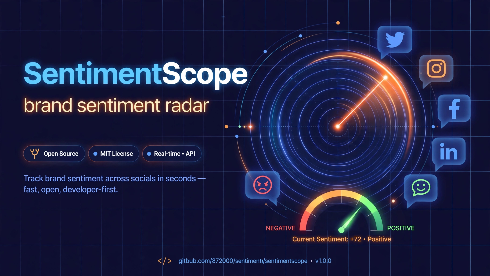
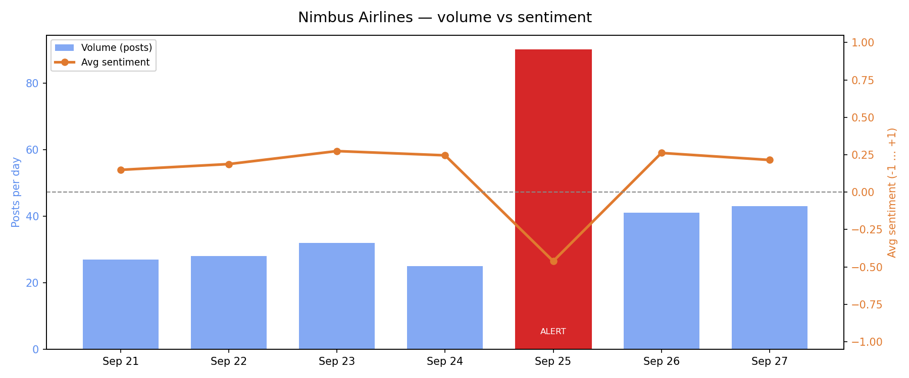
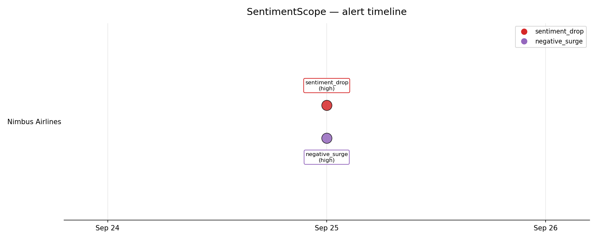

# SentimentScope — brand sentiment radar



[](https://www.python.org/)
[](LICENSE)
[](#quickstart)
[](#tech-stack)

**SentimentScope watches what the internet says about your brand and shouts when the mood turns.**
It scores social posts with a hand-built, fully offline sentiment engine (negation and
intensifier handling written from scratch), aggregates volume vs. sentiment per brand per
day, and fires configurable spike alerts when a PR incident starts brewing — like the
scripted **Nimbus Airlines cancellation meltdown** bundled in the demo data.

No ML models to download, no API keys, no network calls. Just Python + a lexicon.

## Screenshots

Real output from `python -m sentimentscope dashboard` on the bundled dataset:

| Nimbus Airlines — volume vs sentiment | Alert timeline |
|---|---|
|  |  |

On 2026-09-25 a wave of flight cancellations hits Nimbus Airlines: daily volume triples
to 90 posts, average sentiment crashes from +0.25 to −0.46, and two **HIGH** alerts fire.

## Features

- **Hand-built sentiment engine** — ~525 curated lexicon entries, implemented from
  scratch (no VADER, TextBlob, or transformers).
- **Negation handling** — *"not good"* scores negative, *"not bad"* scores positive,
  with a 3-token forward scope that never crosses sentence boundaries.
- **Intensifiers & diminishers** — *"very good"* > *"good"*; *"slightly annoyed"*
  barely registers. Stackable (*"very very good"*).
- **Emphasis signals** — ALL-CAPS words and trailing exclamation marks amplify scores.
- **Spike detection** — configurable alerts for sharp sentiment drops and negative-volume
  surges, with `high`/`medium` severity and a minimum-volume guard against noise.
- **Dashboards** — per-brand dual-axis volume-vs-sentiment charts plus an alert
  timeline, rendered with matplotlib (headless-safe).
- **CLI** — `analyze`, `dashboard`, `alerts`, `demo` subcommands; JSON output for alerts.
- **Scripted demo incident** — 720 seeded, reproducible posts across 3 fictional brands
  over 7 days, including a PR crisis to watch the radar catch.

## How the scoring works

Each lexicon word carries a base weight (`±1.0` standard, `±2.0` strong). The engine:

1. Tokenises text, expanding negation contractions (`"don't"` → `"do not"`).
2. Applies the **next** sentiment word's modifiers:
   - *Intensifier* multiplies it (`very` ×1.5, `extremely` ×2.0, `slightly` ×0.5…)
   - *Negator* flips its sign and dampens ×0.7 — negated sentiment is weaker than the
     direct opposite (`"not terrible"` ≈ mildly good), within a 3-token scope.
3. Adds emphasis: ALL-CAPS ×1.25, trailing `!` ×1.15 (`!!` ×1.25).
4. Sums everything and normalises: `score = raw / (|raw| + 2)` → `[-1, +1]`.
5. Labels: `≥ +0.25` positive, `≤ −0.25` negative, else neutral.

```console
$ python -m sentimentscope analyze "not good, very disappointing" -v
score: -0.5238   label: negative
    'good'               -0.700
    'disappointing'      -1.500
```

## Tech stack

- **Lexicon-based sentiment analysis** — curated word lists + rule engine, no models
- **Negation / intensifier handling** — custom scope-based implementation
- **Spike detection** — day-over-day sentiment drop & trailing-mean negative-surge rules
- **matplotlib** (pinned) — dashboard PNGs; everything else is stdlib
- **pytest** — 23-test suite covering engine, aggregation, and alerts

## Quickstart

```bash
git clone https://github.com/872000/sentimentscope.git
cd sentimentscope
pip install -r requirements.txt        # matplotlib only; everything else is stdlib

# 1. Score some text
python -m sentimentscope analyze "The oat latte was absolutely fantastic!"

# 2. Score posts from the bundled dataset
python -m sentimentscope analyze --dataset data/sample_posts.csv \
    --brand "Nimbus Airlines" --date 2026-09-25 --limit 5

# 3. Run spike detection
python -m sentimentscope alerts
python -m sentimentscope alerts --json   # machine-readable

# 4. Generate dashboards (PNGs land in assets/)
python -m sentimentscope dashboard

# 5. The full story in one command: score → aggregate → alerts → dashboards
python -m sentimentscope demo

# 6. Run the test suite
python -m pytest
```

## CLI reference

| Command | What it does |
|---|---|
| `analyze TEXT [-v]` | Score free text; `-v` shows per-token contributions |
| `analyze --dataset CSV [--brand B] [--date D] [--limit N]` | Score bundled (or your own) posts |
| `alerts [--json] [--config PATH]` | Print spike alerts, optionally as JSON |
| `dashboard [--out DIR]` | Generate PNGs + print a brand summary |
| `demo` | End-to-end: scoring → aggregation → alerts → dashboards |

Bring your own data with the same CSV shape (`id,brand,date,source,text`) via `--dataset`.

## Project structure

```
sentimentscope/
├── sentimentscope/          # the package
│   ├── lexicon.py           # hand-built word lists (~525 entries) + negators/intensifiers
│   ├── engine.py            # scoring rules: negation, intensifiers, emphasis, normalisation
│   ├── data.py              # CSV loading, offline scoring, per-brand per-day aggregation
│   ├── alerts.py            # spike detection (sentiment_drop, negative_surge)
│   ├── dashboard.py         # matplotlib charts (Agg backend, headless-safe)
│   └── cli.py               # argparse CLI: analyze / dashboard / alerts / demo
├── tools/
│   └── generate_sample_data.py   # seeded generator for the bundled dataset
├── data/
│   └── sample_posts.csv     # 720 posts, 3 fictional brands, 7 days, 1 scripted PR incident
├── tests/
│   └── test_sentiment.py    # 23 tests: engine, negation, intensifiers, alerts
├── assets/                  # hero banner + generated dashboard PNGs
├── config.json              # alert thresholds + dashboard settings
├── requirements.txt         # matplotlib pinned; stdlib otherwise
└── pyproject.toml
```

## Configuration

`config.json` holds the alert thresholds — tune them to your noise tolerance:

```json
{
  "alerts": {
    "sentiment_drop_threshold": 0.35,
    "negative_surge_threshold": 0.25,
    "min_volume": 20
  }
}
```

- `sentiment_drop_threshold` — fire when avg sentiment falls this much vs yesterday.
- `negative_surge_threshold` — fire when the negative share jumps this much vs the
  trailing 3-day mean.
- `min_volume` — ignore quiet days so small samples can't trigger alerts.

Severity is `high` when a move exceeds 1.4× its threshold, else `medium`.

## Roadmap

- [ ] Streaming mode: watch a folder/queue of incoming posts and alert in near-real time
- [ ] Per-aspect sentiment (price vs. service vs. product) instead of whole-post scores
- [ ] Web dashboard (FastAPI + htmx) alongside the PNG reports
- [ ] Emoji and hashtag sentiment handling
- [ ] Export alerts to Slack/Discord webhooks

## License

MIT — see [LICENSE](LICENSE).
